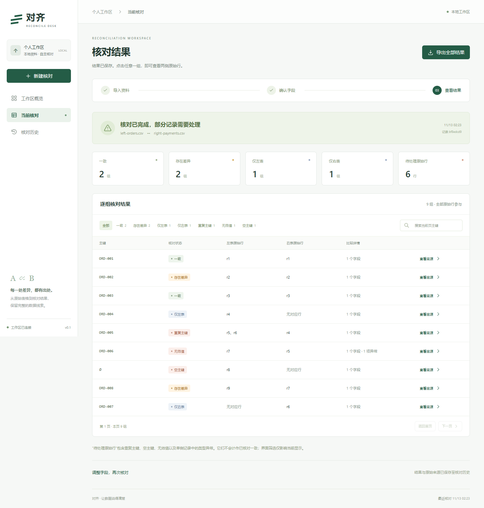

# 对齐 · Reconcile Desk

导入两份表格，明确主键和比较规则，逐行核对并查看来源，导出可追溯的 XLSX。面向单人、本机运行的资料核对工作台。

技术栈：React / TypeScript / FastAPI / PostgreSQL / SQLAlchemy / Alembic / Decimal / Docker Compose / Nginx。



## 启动

Windows 用户从 [v0.1.0 Release](https://github.com/Gabriel6324/reconcile-desk/releases/tag/v0.1.0) 下载 `ReconcileDesk-Windows.zip`，完整解压后双击包内的 `启动.cmd`，等待浏览器自动打开；用完双击 `停止.cmd`。运行包包含 Python、PostgreSQL、VC 运行库和构建后的网页，无需安装开发环境或 Docker。面向 Windows 10 / 11 x64，资料保存在包内 `data` 目录，搬移时先停止再移动整个文件夹。请保留启动窗口。

2026-11-13 已从最终 ZIP 的全新中文目录完成首次初始化、9 项浏览器流程检查、重复启动复用、正常停止及搬移后重开验证；核对历史和导出哈希保持一致。证据见 `evidence/portable/verification.json`。尚未在干净 Windows 虚拟机或其他电脑独立验收。真实模型接口仍未配置，完整手工映射流程可离线使用。

### 从源码运行

```bash
git clone https://github.com/Gabriel6324/reconcile-desk.git
cd reconcile-desk
```

安装并启动 Docker Desktop（Windows 使用 Linux containers）。在项目目录执行：

```powershell
powershell -ExecutionPolicy Bypass -File scripts/init-env.ps1
docker compose up -d --build
```

macOS / Linux 先执行 `sh scripts/init-env.sh`，然后使用同一条 Compose 命令。

打开 <http://127.0.0.1:8080>。数据库仅在容器网络中使用，网页仅绑定本机。首次启动会自动迁移数据库；健康检查通过后网页才启动。

停止：`docker compose stop`。更新代码后：`docker compose up -d --build`。数据保存在 `reconcile_data` 命名卷；保留该卷即可保留历史。不要使用 `docker compose down -v`，它会删除数据库卷。

## 演示流程

1. 新建核对，选择项目 `samples/left-orders.csv` 和 `samples/right-payments.csv`。
2. 主键选择「订单编号」↔「业务单号」，保持精确匹配。
3. 比较「金额」↔「实付金额」，类型选择十进制数；可另加客户与状态的文本比较。
4. 确认字段后执行，查看差异、重复主键、空主键和无效金额。点击结果查看原始行。
5. 导出 XLSX，然后刷新页面，从历史记录打开同一结果。

此样例仅比较金额时的预期：一致 2 组、差异 2 组、仅左 1 组、仅右 1 组、重复主键 1 组、无效值 1 组、空主键 1 组，左右合计 16 行。`9007199254740993.01` 与 `.02` 相差 `0.01`，计算不经浮点数。

页面内置的示例文件另有明确标注，所有展示结果均由后端实际核对生成。

## 输入规则

- CSV：UTF-8（可带 BOM）、逗号分隔、首行表头。XLSX：单工作表、首行表头。
- 每文件最多 10 MiB、10,000 数据行、50 列；每单元格最多 4,000 字符。解析后的文本与压缩包展开体积另有限制。
- 表头不能重复或为空；公式、多表、外部引用、合并数据单元格、非法控制字符等返回明确错误。
- 主键必须来自文本值；重复和空主键单独列出，避免错误配对。
- 文本默认逐字比较。可显式选择仅裁剪 ASCII 空白。金额选择 Decimal；无效或缺失数值保留为待核查，绝不自动当零。
- 导出包含全部结果和来源；页面筛选不改变导出范围。文本按字面写入，不作为公式或自动超链接执行。

## 可选模型配置

未配置模型时，手动映射与核对流程可以独立使用。若有 OpenAI 兼容接口，在本机 `.env` 设置 `LLM_BASE_URL`（以 `/v1` 结尾）、`LLM_MODEL` 和 `LLM_API_KEY`，重建 API 服务。

模型请求由用户主动触发，提供字段建议，须明确应用并复核。原始资料中的指令只作为数据。核对结果由确定性代码计算。模型密钥只留在后端运行环境，勿写入前端或提交 `.env`。

当前用户暂无接口，真实模型响应、计费和最终容器内模型连通性待验收。模拟接口检查不代表真实模型验收。

## 验证边界

实际运行证据保存在 `evidence/verification.json`。2026-11-10 的 119 项自动化测试通过，包含 75 项核心测试、23 项模拟模型接口测试、19 项真实 PostgreSQL 集成与回归测试、2 项上传接收边界测试。浏览器的 9 项流程检查、实际 XLSX 下载语义检查及本机数据库恢复后的历史和导出哈希核验通过。

本机未安装 Docker，因此镜像构建、容器完整流程与保留卷重建验证仍待执行。原计划中其余故障注入场景逐项记录在 `evidence/acceptance-status.json`，完整发布验收保持待完成状态。

本地开发使用 Python 3.12、Node.js 22.12+ 和 PostgreSQL 17。安装 `backend/requirements.txt`，设置 `DATABASE_URL`，在 backend 下执行 `python -m uvicorn api.main:app --host 127.0.0.1 --port 8000`。在 frontend 下执行 `npm ci` 与 `npm run dev`。

在 backend 下执行 `python -m pytest tests/core tests/api/test_model.py -q` 可检查核心与模拟模型接口。完整测试先设置 `TEST_DATABASE_URL`，数据库名必须为 `reconcile_test`，再执行 `python -m pytest tests -q`。集成测试会重建这个专用测试库的 public schema。

验收结果以 `evidence/verification.json` 为准。`python scripts/verify-evidence.py` 检查交付代码是否仍与验收指纹一致，修改后需要重新验证。[GitHub Actions 远端检查](https://github.com/Gabriel6324/reconcile-desk/actions/runs/43281908204)已通过：Linux / PostgreSQL 17.11 环境中 119 项后端测试及前端构建全部成功。这不等同于应用完整 Docker Compose 流程或真实模型验收。

浏览器复测脚本为 `scripts/browser-smoke.cjs`，需要安装 Playwright，并设置 `BROWSER_EXECUTABLE` 指向可用的 Chromium / Edge。服务启动后执行 `node scripts/browser-smoke.cjs`，脚本会上传标注样例、生成新记录并核验实际下载。可用 `PLAYWRIGHT_MODULE` 指向已有的 Playwright 模块目录。

项目用于有明确边界的本地核对展示；当前版本不提供多人权限、模糊匹配、财务记账或聚合对账。

`Start-Local.ps1` 是原开发工作区专用入口，依赖同一工作区的 `work/runtime`。下载仓库的用户请使用上面的运行包或源码运行步骤。
